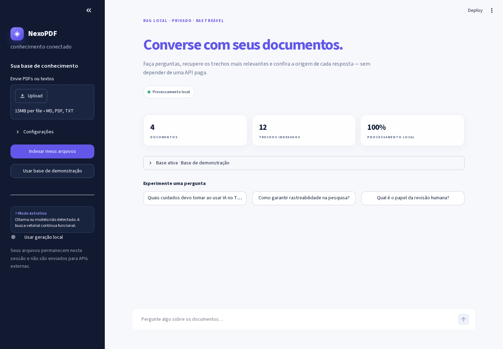
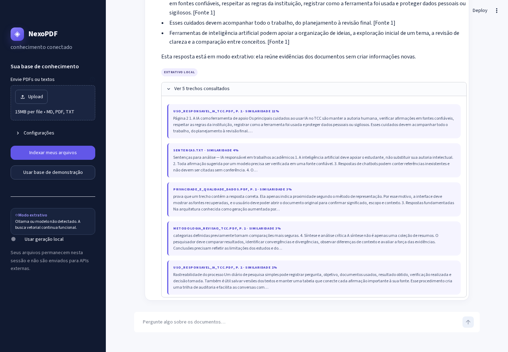
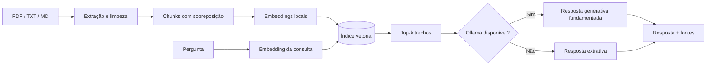

<div align="center">

# ◈ NexoPDF

### Converse com seus documentos usando busca vetorial e IA local

[](https://www.python.org/)
[](https://streamlit.io/)
[](https://ollama.com/)
[](#testes)
[](LICENSE)

**Privado por padrão · fontes rastreáveis · sem API paga**

</div>



## Sobre o projeto

O **NexoPDF** é um chat local capaz de responder perguntas com base no conteúdo de arquivos PDF, TXT e Markdown. O projeto implementa um fluxo de **RAG (Retrieval-Augmented Generation)**: os documentos são extraídos, divididos em trechos, transformados em vetores e consultados antes da elaboração de cada resposta.

Ele foi desenvolvido para o desafio **“Criando um Chatbot Baseado em Conteúdo de PDFs”**, da DIO, com foco em três propriedades:

- **fundamentação:** a resposta parte de trechos realmente recuperados;
- **rastreabilidade:** cada evidência informa arquivo, página e similaridade;
- **privacidade:** a indexação ocorre localmente e não exige serviços pagos.

O app já inicia com uma base de demonstração autoral sobre **uso responsável de IA em trabalhos acadêmicos**, alinhada ao cenário de um estudante preparando o TCC.

## Demonstração



Perguntas disponíveis na demonstração:

- “Quais cuidados devo tomar ao usar IA no TCC?”
- “Como garantir rastreabilidade na pesquisa?”
- “Qual é o papel da revisão humana?”

## Funcionalidades

- upload simultâneo de arquivos `.pdf`, `.txt` e `.md`;
- extração de texto por página com `pypdf`;
- chunking de 170 palavras, com sobreposição de 35 palavras;
- índice vetorial privado mantido em memória;
- busca leve com vetores TF-IDF, sem baixar modelos;
- opção de embeddings semânticos multilíngues com MiniLM;
- respostas generativas locais por meio do Ollama;
- fallback extrativo quando o modelo generativo não está disponível;
- referências com nome do arquivo, página e pontuação de similaridade;
- base de demonstração carregada automaticamente;
- interface responsiva desenvolvida em Streamlit;
- 15 testes automatizados e workflow-modelo do GitHub Actions em `docs/`;
- Dockerfile e Docker Compose para execução reproduzível.

## Arquitetura



### Fluxo de uma pergunta

1. O texto dos documentos é extraído e normalizado.
2. Cada página é dividida em trechos parcialmente sobrepostos.
3. Os trechos são representados por vetores e armazenados no índice da sessão.
4. A pergunta é vetorizada com o mesmo método.
5. A similaridade de cosseno seleciona os trechos mais relacionados.
6. Se o Ollama estiver ativo, esses trechos formam o contexto do modelo local.
7. Sem Ollama, o sistema seleciona as sentenças mais relevantes de forma extrativa.
8. A interface exibe a resposta e permite inspecionar as evidências utilizadas.

## Tecnologias

| Camada | Tecnologia | Papel |
|---|---|---|
| Interface | Streamlit | Upload, chat, configurações e fontes |
| Extração | pypdf | Leitura do texto e dos números de página |
| Vetorização padrão | scikit-learn / TF-IDF | Busca local leve e imediata |
| Vetorização opcional | FastEmbed / MiniLM | Similaridade semântica multilíngue via ONNX |
| Cálculo | NumPy e SciPy | Operações vetoriais e ranking |
| Geração opcional | Ollama + Qwen 2.5 | Resposta generativa executada localmente |
| Qualidade | Pytest e Ruff | Testes e análise estática |

## Como executar

### Pré-requisitos

- Python 3.10 ou superior;
- Git;
- Ollama apenas se você quiser respostas generativas locais.

### 1. Clonar e instalar

```bash
git clone https://github.com/gabrielnasciimentoleandro-arch/nexopdf-chat-rag-local.git
cd nexopdf-chat-rag-local

python -m venv .venv
```

Ativação do ambiente:

```bash
# Linux ou macOS
source .venv/bin/activate

# Windows PowerShell
.venv\Scripts\Activate.ps1
```

Instale as dependências:

```bash
pip install -r requirements.txt
```

### 2. Iniciar a aplicação

```bash
streamlit run app.py
```

Abra `http://localhost:8501`. A demonstração funciona imediatamente em **modo extrativo**, sem chave, login ou modelo adicional.

### 3. Ativar respostas generativas locais

Instale o [Ollama](https://ollama.com/) e execute:

```bash
ollama pull qwen2.5:3b
ollama serve
```

Recarregue o NexoPDF. O indicador lateral mudará para **Ollama conectado** e a opção de geração local ficará disponível.

> O modelo roda no computador do usuário. A memória necessária varia conforme o modelo escolhido. É possível escrever outro modelo instalado no campo “Modelo Ollama”.

### 4. Ativar embeddings semânticos

O modo padrão TF-IDF é rápido e não baixa modelos. Para habilitar o MiniLM multilíngue:

```bash
pip install -r requirements-semantic.txt
```

Depois, selecione **Semântica · MiniLM** nas configurações. Na primeira execução, o FastEmbed baixa aproximadamente 220 MB do modelo ONNX; as execuções seguintes podem ocorrer localmente.

## Executar com Docker

```bash
docker compose up --build
```

Acesse `http://localhost:8501`. O Compose já configura o app para procurar o Ollama na máquina hospedeira por meio de `host.docker.internal`.

## Estrutura do repositório

```text
pdf-chat-rag-local/
├── .streamlit/config.toml            # tema e limites do app
├── docs/github-actions-quality.yml   # workflow-modelo de CI
├── assets/screenshots/               # prints reais da aplicação
├── inputs/                           # documentos da demonstração
│   ├── metodologia_revisao_tcc.pdf
│   ├── privacidade_e_qualidade_dados.pdf
│   ├── sentencas.txt
│   └── uso_responsavel_ia_tcc.pdf
├── scripts/
│   ├── capture_screenshots.py        # gera os prints do README
│   ├── generate_sample_pdfs.py       # recria os PDFs autorais
│   └── qa_browser.py                 # smoke test do fluxo real no navegador
├── src/
│   ├── document_processor.py         # extração, limpeza e chunking
│   ├── embeddings.py                 # TF-IDF e MiniLM
│   ├── models.py                     # modelos de domínio
│   ├── ollama_client.py              # integração local com Ollama
│   ├── rag.py                        # recuperação e resposta
│   └── vector_store.py               # índice e similaridade
├── tests/                             # testes automatizados
├── app.py                             # interface Streamlit
├── Dockerfile
├── docker-compose.yml
└── requirements.txt
```

## Testes

```bash
pip install -r requirements-dev.txt
pytest
ruff check src tests app.py scripts
```

Resultado atual:

```text
15 passed
All checks passed!
```

Os testes cobrem limpeza, chunking, sobreposição, extração dos PDFs de exemplo, formatos inválidos, ranking vetorial, deduplicação de fontes, resposta extrativa, geração local simulada, detecção do modelo Ollama e construção do prompt com citações.

Com a aplicação ativa e as dependências de documentação instaladas, também é possível validar demonstração, chat e upload em um navegador real:

```bash
pip install -r requirements-docs.txt
playwright install chromium
python scripts/qa_browser.py
```

## Processo de desenvolvimento

### 1. Preparação dos documentos

Foram criados três PDFs autorais e um arquivo de sentenças na pasta `inputs`. Os textos tratam de integridade acadêmica, revisão de literatura, privacidade e qualidade em sistemas RAG. O script `generate_sample_pdfs.py` permite recriar os PDFs e evita depender de materiais protegidos por direitos autorais.

### 2. Ingestão e fragmentação

A extração preserva o número da página. Depois da limpeza, o conteúdo é dividido em janelas de palavras com sobreposição. A sobreposição reduz a chance de perder uma ideia que cruza o limite entre dois trechos.

### 3. Indexação e recuperação

A configuração leve cria vetores TF-IDF normalizados. O produto entre o vetor da pergunta e a matriz de documentos equivale à similaridade de cosseno. Também foi implementado um provedor opcional de embeddings neurais, mantendo a arquitetura desacoplada.

### 4. Geração fundamentada

Os melhores trechos são numerados e enviados ao modelo local. O prompt determina que o assistente use apenas o contexto recuperado, indique fontes e admita ausência de informação. Se o Ollama estiver indisponível, o projeto continua funcional com uma síntese extrativa identificada como tal.

### 5. Validação

Foram adicionados testes automatizados, lint, um workflow-modelo para GitHub Actions, tratamento de PDFs protegidos, limite recomendado de tamanho e indicação visual do modo ativo.

## Insights aprendidos

1. **Chunking é uma decisão de recuperação, não apenas de armazenamento.** Trechos muito curtos perdem contexto; trechos muito longos misturam assuntos e reduzem a precisão.
2. **Similaridade não é prova.** Um resultado vetorial indica proximidade matemática. Mostrar a fonte permite que a pessoa valide se o trecho realmente sustenta a resposta.
3. **RAG reduz, mas não elimina, alucinações.** O prompt, a qualidade dos documentos e a revisão humana continuam essenciais.
4. **Fallback melhora a experiência.** Mesmo sem um LLM ou conexão, a recuperação vetorial pode produzir uma resposta útil e verificável.
5. **Metadados tornam o chat auditável.** Arquivo e página transformam uma resposta isolada em um caminho de verificação.
6. **Privacidade depende de toda a arquitetura.** Processar localmente ajuda, mas arquivos temporários, logs, backups e acesso ao dispositivo também precisam ser considerados.
7. **Interfaces devem comunicar incerteza.** O usuário precisa saber se está vendo uma geração, uma extração e quais evidências foram utilizadas.

## Possibilidades futuras

- OCR para PDFs digitalizados;
- índice persistente com FAISS, Chroma ou Qdrant;
- reranqueamento dos resultados recuperados;
- filtros por autor, data, assunto e tipo de documento;
- visualização do PDF diretamente na página citada;
- avaliação automática com conjunto de perguntas conhecidas;
- histórico persistente e exportação das conversas;
- autenticação e bases separadas por usuário;
- suporte a DOCX, páginas web e planilhas;
- execução de modelos locais maiores conforme o hardware disponível.

## Limitações conhecidas

- o `pypdf` não executa OCR em documentos escaneados;
- tabelas, fórmulas e PDFs em múltiplas colunas podem ser extraídos fora de ordem;
- o índice atual vive apenas durante a sessão;
- o TF-IDF privilegia correspondência lexical; use MiniLM para maior proximidade semântica;
- o modo generativo depende de um servidor Ollama e de um modelo instalado;
- citações ajudam na auditoria, mas ainda devem ser conferidas no documento original.

## Checklist da entrega DIO

- [x] repositório estruturado e pronto para o GitHub;
- [x] pasta `inputs` com PDFs e arquivo de sentenças;
- [x] chat funcional baseado nos documentos;
- [x] busca vetorial e recuperação de trechos;
- [x] integração opcional com IA generativa local;
- [x] prints reais da aplicação;
- [x] processo, insights e possibilidades documentados;
- [x] testes automatizados;
- [x] licença de código aberto.

## Segurança e uso responsável

Não envie documentos confidenciais sem autorização. O projeto foi desenhado para estudo e portfólio; valide respostas importantes nas fontes originais. Os materiais da demonstração são autorais e possuem finalidade exclusivamente educacional.

## Autor

Desenvolvido por [0Barone](https://github.com/gabrielnasciimentoleandro-arch) como projeto de portfólio para o desafio da DIO.

## Licença

Distribuído sob a licença [MIT](LICENSE).
